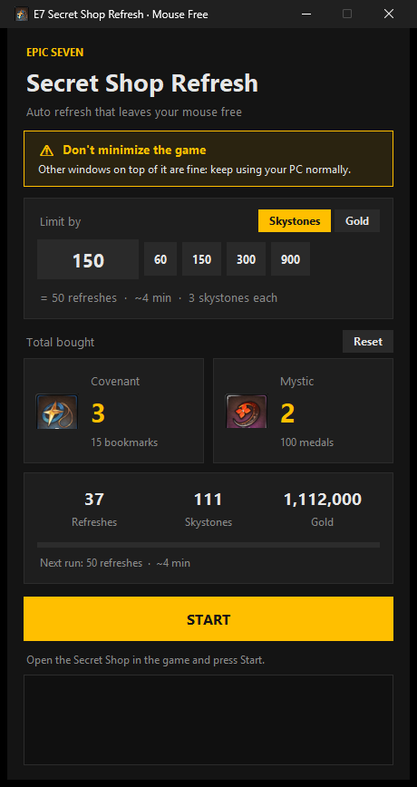

# E7 Secret Shop Refresh: Mouse Free

Refreshes the Epic Seven **Secret Shop** for you and buys every **Covenant Bookmark** and
**Mystic Medal** that shows up. Your mouse stays free the whole time, so you can keep using
your PC while it runs.



> [!WARNING]
> **Use at your own risk.** Automating Epic Seven is against Smilegate's Terms of Service.
> Your account could be warned, suspended or banned, and the game could change in a way
> that makes this tool misbehave. The author takes no responsibility for anything that
> happens to your account, gold or skystones. See the [Disclaimer](#disclaimer).

## What you need

- Windows 10 or 11
- The Epic Seven **PC client** (the one from the official launcher)
- That's it. No Python or anything else to install.

## How to use

1. Download **`E7ShopRefresh.exe`** from the [Releases](../../releases/latest) page.
2. Open Epic Seven and go to the **Secret Shop**.
3. Open `E7ShopRefresh.exe` and click **Yes** when Windows asks for administrator.
4. Choose your limit:
   - **Skystones**: how many skystones to spend (each refresh costs 3).
   - **Gold**: how much gold to spend. It never buys something that goes over it.
     There is no skystone limit in this mode.
5. Press **START**. Press **STOP** (or Esc) whenever you want.

You can use your PC normally while it runs. Just **don't minimize the game**; it's fine
behind other windows.

The counters (Covenant, Mystic, refreshes, skystones, gold) add up across runs, even after
closing the app. Press **Reset** to zero them.

## Common questions

**Why does it ask for administrator?**
The Epic Seven PC client runs as administrator, and Windows blocks clicks coming from
programs that are not.

**Windows Defender says the file is unsafe.**
This happens with many small tools made in Python. You can click "More info" → "Run anyway",
or run it from the source code (below).

**It doesn't find the items.**
Keep the game window in a normal 16:9 size and the Secret Shop open when you press START.

**Can I get banned?**
Yes, it's possible. See the [Disclaimer](#disclaimer).

## How it works

1. **Looking at the screen.** About once a second it takes a screenshot of the game window
   only (not your whole screen), straight from the window itself. That's why the game can
   be behind other windows, but not minimized: a minimized window has nothing to capture.
2. **Finding the items.** It compares the screenshot with small pictures of the Covenant and
   Mystic icons (image matching with OpenCV). If an icon is found, it knows which row of the
   shop the item is on.
3. **Clicking without your mouse.** Normal macros move your real cursor. This one sends
   the click as a message straight to the game window (the same kind of message Windows
   itself sends when you click). Your cursor never moves, so you can keep using it.
4. **Where it clicks.** Buttons are found by their position in the game window (for example,
   "Buy" is on the right side of the item's row, "Refresh" is in the bottom left). Positions
   are proportional, so any 16:9 window size works.
5. **The loop.** Check the shop → buy what it found → scroll down → check again → refresh →
   repeat, until your skystone or gold limit is reached or you press STOP.
6. **Acting like a person.** Each click waits a random time first, hits a slightly different
   spot of the button and is held for a random time. Every now and then it pauses for a few
   seconds. It's still about as fast as a person clicking quickly.

## Run from the source code (optional)

For people who prefer not to use the `.exe`. Needs [Python](https://www.python.org/downloads/).

```
pip install -r requirements.txt
```

Then double-click `e7_shop_gui.pyw`. To build the `.exe` yourself, run `build.bat`.

## Credits

The Covenant and Mystic icons and the button positions come from
**[Solunium/Epic-Seven-E7-Secret-Shop-Refresh](https://github.com/Solunium/Epic-Seven-E7-Secret-Shop-Refresh)**.
Thanks to Solunium for the original project.

## Disclaimer

- Automating Epic Seven is against Smilegate's Terms of Service. Using this tool can get
  your account warned, suspended or permanently banned.
- Game updates can change the shop layout. If that happens, the tool may click the wrong
  place or buy the wrong thing. Watch it the first few times and after every game update.
- This software is provided "as is", without any warranty. The author is not responsible
  for any loss of account, items, gold or skystones.
- This project is not affiliated with, endorsed by or connected to Smilegate or Epic Seven.
  All game names and images belong to their owners.

## License

[GPL-3.0](LICENSE), the same license as the original project.
